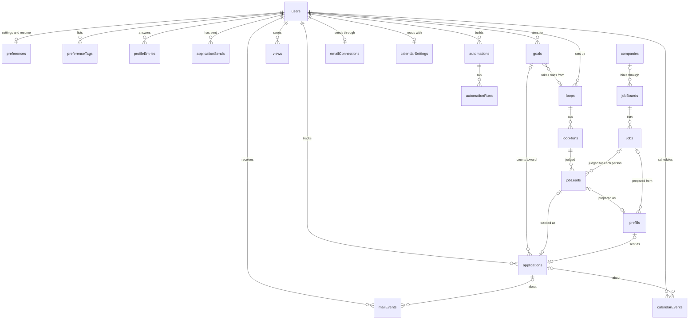
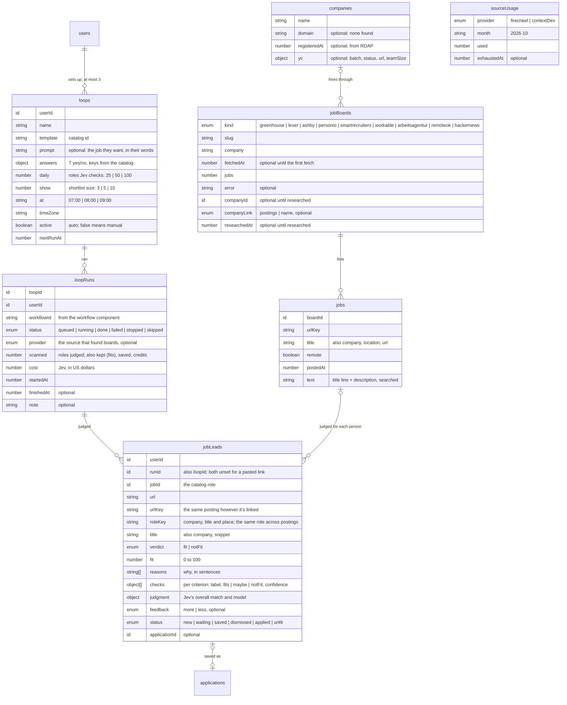
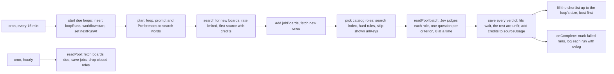

# Database design

The schema as it is today: 30 tables in `convex/schema.ts`, grouped by what they're about, plus the components' own tables. Each table is defined in its feature's `models.ts` or `models/` folder, mostly from shapes in that feature's `validators.ts`.

[Proposed changes](#proposed-changes) lists what's waiting on a real problem and what's decided against.

## When something gets its own table

Every table adds a schema, indexes, delete rules and an extra lookup when reading. Something gets a table only when it passes at least one of these:

1. **It grows without a limit.** Convex caps a document at 1 MiB and an array at 8192 items. Mail and job leads grow forever, while a form's questions don't.
2. **Several records point at it by id.**
3. **It has its own owner or lifetime.** Open roles stay after the person who found them deletes their account.
4. **You query it on its own, across parents.** "Which loops are due?" across everyone.

Otherwise it's a field on its parent, either an object or an array with a cap.

Signs there are too many tables:

- A table that always has exactly one row per parent. Make it a field.
- A table you only ever read together with its parent.
- A table that stores a number you could compute from other tables.
- Two tables recording the same event.

## Tables by domain



Convex stores references as typed ids but doesn't enforce them or cascade deletes, so [what happens on delete](#what-happens-when-something-is-deleted) is code.

### You

| Table            | Holds                                                                                                                                        | Why it's a table               | Indexes                        |
| ---------------- | -------------------------------------------------------------------------------------------------------------------------------------------- | ------------------------------ | ------------------------------ |
| `users`          | name, email, username, image, `trashDays`, `onboardedAt`, `prepareAt`, `anonymous`, `allowedSearch`                                          | Convex Auth points at it       | `by_userName`, `by_imageId`    |
| `preferences`    | one row per person: `workMode`, the resume file, its text and last review, `prefilledAt`                                                     | exception: keeps `users` basic | `by_userId`, `by_resumeId`     |
| `preferenceTags` | one row per interest, skill, place, company or thing to avoid                                                                                | 1                              | `by_userId_and_kind_and_order` |
| `profileEntries` | one row per answer (`kind: answer`) or saved form field (`kind: field`), with usage stamps, and `byAgent` until you save what an agent wrote | 1                              | `by_userId_and_kind_and_order` |

Built-in questions are a list in code (`preferences/rows.ts`), keyed so a label can change without touching stored answers.

### Your search

| Table              | Holds                                                                                                                                                                           | Why it's a table | Indexes                                                                                                               |
| ------------------ | ------------------------------------------------------------------------------------------------------------------------------------------------------------------------------- | ---------------- | --------------------------------------------------------------------------------------------------------------------- |
| `applications`     | company, role, status, url, details, `goalId`, `number` (APP-1), its stored `fit` and `mail` summary, and capped arrays: `history` (100), `notes` (100), `tasks` (50), `labels` | 1, 4             | `by_userId`, `by_userId_and_goalId`, `by_userId_and_trashedAt`, `by_userId_and_number`, `by_archivedAt`, `by_purgeAt` |
| `applicationSends` | one row per sent application: `applicationId` and `at`, for streaks                                                                                                             | 1, 3             | `by_userId_and_at`, `by_applicationId`                                                                                |
| `goals`            | what the search is for, its dates, up to 20 milestones, an optional `loopId`                                                                                                    | 2                | `by_userId`                                                                                                           |
| `views`            | a saved set of filters and display options                                                                                                                                      | 1                | `by_userId`                                                                                                           |

`applications.history` is a capped array, not a table: a handful per application, only read with it. Every status change goes through `changeStatus`, so status and history always match.

### Open roles (shared)

These have no owner. Deleting an account leaves them.

| Table         | Holds                                                                | Why it's a table | Indexes                                                                                           |
| ------------- | -------------------------------------------------------------------- | ---------------- | ------------------------------------------------------------------------------------------------- |
| `companies`   | one per website domain: its registration date and YC details         | 1, 3             | `by_domain`                                                                                       |
| `jobBoards`   | one feed the catalog reads, usually a company's board, and its count | 2, 3             | `by_kind_and_slug`, `by_fetchedAt`, `by_jobs`, `by_researchedAt`, `by_companyId`                  |
| `jobCatalog`  | one row: how many boards the catalog has                             | 3                | none                                                                                              |
| `jobs`        | one open role from a board's feed, with its text for search          | 1, 3, 4          | `by_urlKey`, `by_boardId_and_postedAt`, `by_postedAt`, `by_remote_and_postedAt`, search on `text` |
| `sourceUsage` | credits each search source used this month                           | 3                | `by_provider_and_month`                                                                           |

A company row holds what's true of a domain. How a board reached that domain is on the board (`companyLink`): `postings` when its postings live on that site, `name` when only a domain matching its name turned up. Anyone can open a board under a copied name, so a copycat of a known company shares the real row but keeps `name`, and never reads as posting on that site. A board with no site found has a row of its own, since a name alone can't say two boards are one company.

### Finding roles and getting them ready

| Table      | Holds                                                                                                                  | Why it's a table | Indexes                                                                                                                                                                                |
| ---------- | ---------------------------------------------------------------------------------------------------------------------- | ---------------- | -------------------------------------------------------------------------------------------------------------------------------------------------------------------------------------- |
| `loops`    | a saved search: its answers, size, time and next run                                                                   | 4                | `by_userId`, `by_active_and_nextRunAt`                                                                                                                                                 |
| `loopRuns` | one run's counts and cost, and while it runs, Jev's verdicts so far                                                    | 1                | `by_loopId_and_startedAt`, `by_userId_and_startedAt`                                                                                                                                   |
| `jobLeads` | a role judged for one person: verdict, fit, reasons, checks, where it stands                                           | 1, 4             | `by_userId_and_urlKey`, `by_userId_and_roleKey`, `by_userId_and_status`, `by_userId_and_feedback`, `by_userId_and_verdict_and_fit`, `by_loopId_and_status_and_fit`, `by_applicationId` |
| `prefills` | an application made ready: every question on the form with its answer and source, and the live browser while it's open | 2, 4             | `by_userId`, `by_userId_and_status`, `by_userId_and_urlKey`, `by_userId_and_applicationId`                                                                                             |

`prefills.fields` is an array, capped at 80, not a table: a form is bounded and only read with its application.

### Mail

| Table                                                                                                                          | Holds                                                                                   | Why it's a table                        | Indexes                                                                                                                                                                                     |
| ------------------------------------------------------------------------------------------------------------------------------ | --------------------------------------------------------------------------------------- | --------------------------------------- | ------------------------------------------------------------------------------------------------------------------------------------------------------------------------------------------- |
| `emailConnections`                                                                                                             | one per person: a sealed Cloudflare token and details, what's allowed, incoming mail    | exception: keeps secrets out of `users` | `by_userId`, `by_inboundId`                                                                                                                                                                 |
| `mailEvents`                                                                                                                   | one sorted email: its kind, the application it's about, a sealed note, a suggested move | 1, 4                                    | `by_userId_and_applicationId_and_at`, `by_userId_and_at`, `by_userId_and_kind_and_at`, `by_userId_and_box_and_at`, `by_userId_and_box_and_readAt`, `by_emailId`, `by_userId_and_messageKey` |
| `contacts`                                                                                                                     | one person per address: sealed details, a hash of the address, how many emails, when    | 1, 4                                    | `by_userId_and_key`, `by_userId_and_lastAt`, `by_userId_and_applicationId`                                                                                                                  |
| `mailLabels`                                                                                                                   | one per label you use, with how many emails have it                                     | 1                                       | `by_userId_and_name`                                                                                                                                                                        |
| `mailEventLabels`                                                                                                              | one label on one email, so a label's mail is a page and not a scan                      | 1                                       | `by_userId_and_label_and_at`, `by_eventId`                                                                                                                                                  |
| `mailDrafts`                                                                                                                   | one unsent email, sealed                                                                | 1                                       | `by_userId_and_updatedAt`                                                                                                                                                                   |
| `mailTemplates`                                                                                                                | one reusable email: name, subject and body                                              | 1                                       | `by_userId_and_updatedAt`                                                                                                                                                                   |
| The emails themselves live in the `cloudflareEmail` component, sealed. `mailEvents.emailId` is a plain string for that reason. |

### Time

| Table              | Holds                                                                                      | Why it's a table               | Indexes                                                                                                                  |
| ------------------ | ------------------------------------------------------------------------------------------ | ------------------------------ | ------------------------------------------------------------------------------------------------------------------------ |
| `calendarEvents`   | an event you added or fixed, keyed by the id the calendar gave it; `replaces` and `hidden` | 1                              | `by_userId_and_key`, `by_userId_and_applicationId`, `by_userId_and_end`, `by_userId_and_replaces`, `by_userId_and_rrule` |
| `calendarSettings` | how you read your calendar                                                                 | exception: keeps `users` basic | `by_userId`                                                                                                              |

### Workflows

| Table            | Holds                                                                                              | Why it's a table | Indexes                                |
| ---------------- | -------------------------------------------------------------------------------------------------- | ---------------- | -------------------------------------- |
| `automations`    | a workflow you built: trigger and steps, as data, and `byAgent` until you save what an agent wrote | 4                | `by_userId`, `by_active_and_nextRunAt` |
| `automationRuns` | one run: a copy of its steps, what triggered it, and a log with one entry per step                 | 1                | `by_automationId_and_startedAt`        |

### Activity

| Table            | One row is                                                                                       | Rows per person | Indexes                                                                        |
| ---------------- | ------------------------------------------------------------------------------------------------ | --------------- | ------------------------------------------------------------------------------ |
| `activityEvents` | one thing that happened, kept from its evlog event: what ran, whether it failed, why, and a link | three months    | `by_userId_and_at`, `by_userId_and_failed_and_at`, `by_failed_and_at`, `by_at` |

### Judgments on their way

| Table         | One row is                                                           | Rows per person     | Indexes |
| ------------- | -------------------------------------------------------------------- | ------------------- | ------- |
| `judgedReads` | one finished judgment waiting for the worker that adds it to its run | none, moments later | none    |

### Big deletes

| Table        | One row is                                                                                    | Rows per person         | Indexes |
| ------------ | --------------------------------------------------------------------------------------------- | ----------------------- | ------- |
| `deleteJobs` | one big delete waiting for the batch worker: what kind, whose, and how far through an account | none once it's finished | none    |

### What the components keep

| Component                     | Keeps                                                                                       | The app keeps                                      |
| ----------------------------- | ------------------------------------------------------------------------------------------- | -------------------------------------------------- |
| `@convex-dev/auth`            | accounts and sessions                                                                       | `users`                                            |
| `@convex-dev/batch-worker`    | the loops that run big deletes and add finished judgments to their run, one batch at a time | `deleteJobs`, `judgedReads`                        |
| `@convex-dev/workflow`        | each run's steps, retries and results                                                       | `loopRuns.workflowId`, `automationRuns.workflowId` |
| `@convex-dev/workpool`        | `readPool` (fetches, judgments) and `applyPool` (prepares)                                  | `loopRuns.readWorkIds`                             |
| `@convex-dev/rate-limiter`    | per-source and per-person budgets                                                           | nothing                                            |
| `@convex-dev/aggregate`       | run and answer counts for workflows; roles per board and company; roles per domain          | nothing                                            |
| `@convex-dev/sharded-counter` | the catalog's totals: domains, and roles by proof                                           | nothing                                            |
| `@convex-dev/mcp`             | connected agents, API keys and tokens, stored hashed                                        | the `userId` of whoever approved                   |
| `cloudflareEmail` (local)     | sealed emails                                                                               | `mailEvents.emailId`                               |
| `notifications` (local)       | each person's Updates lines and muted kinds                                                 | a `ref` on each line, or an agent's `message`      |

## What happens when something is deleted

| Deleted                                 | What points at it                                                  | What happens                                                                                                                                                           |
| --------------------------------------- | ------------------------------------------------------------------ | ---------------------------------------------------------------------------------------------------------------------------------------------------------------------- |
| an account                              | everything with `userId`                                           | all of it goes, with the resume and image files and the username. The `users` row stays, empty: Convex Auth reuses the id. Shared tables stay                          |
| an application                          | `mailEvents`, `jobLeads`, `calendarEvents`, `prefills`, `contacts` | each is unlinked and stays: mail goes back to unfiled, a lead stays tracked so loops don't offer the role again, a sent prefill stays closed so it can't be sent twice |
| an application                          | `applicationSends.applicationId`                                   | **left on purpose**: it was still sent, so the Trash can't shorten a streak. Back at Saved does remove it                                                              |
| an application, a prefill or a workflow | `activityEvents.applicationId`, `prefillId`, `automationId`        | the row stays, as a record of what happened. Its **Open** link finds nothing                                                                                           |
| a goal                                  | `applications.goalId`                                              | cleared; the applications stay                                                                                                                                         |
| a loop                                  | `goals.loopId`                                                     | cleared; the goal takes no more roles                                                                                                                                  |
| a loop                                  | `loopRuns.loopId`, `jobLeads.loopId`                               | **left on purpose**: its runs and roles stay, so the Runs tab still adds up                                                                                            |
| a loop                                  | a workflow's Find roles step                                       | left; that step stops with "That loop is gone." when it runs                                                                                                           |
| a role closes on its board              | `jobLeads.jobId`, `prefills.jobId`                                 | **left on purpose**: both keep their own copy, and read a missing job as none                                                                                          |
| a workflow                              | `automationRuns.automationId`                                      | its runs are stopped and deleted, with their Updates lines                                                                                                             |

## What's copied on purpose

Copying isn't always a normalization mistake. These stay, because the copy must outlive what it came from:

| Copy                                                     | From                   | Why                                                                                                                                                       |
| -------------------------------------------------------- | ---------------------- | --------------------------------------------------------------------------------------------------------------------------------------------------------- |
| `jobLeads` and `prefills`: url, title, company           | `jobs`                 | boards drop closed roles, and what you were shown shouldn't vanish                                                                                        |
| `applications`: company, role, url, location             | `jobs`, `jobLeads`     | it's your record, and it has to outlive the posting                                                                                                       |
| `loopRuns.loopName`                                      | `loops`                | a run outlives its loop                                                                                                                                   |
| `automationRuns.steps`, `name`                           | `automations`          | editing a workflow must never change a run already going                                                                                                  |
| `jobBoards.jobs`, `jobCatalog`, the counts on `loopRuns` | counted rows           | Convex has no count, and these are read on every page. `jobBoards.jobs` is the board's count in `jobRoleCounts`, kept for sorting boards with `by_jobs`   |
| `applications.mail`                                      | `mailEvents`           | every card shows it, and reading it there would mean reading and opening mail. `syncMailSummary` recounts on each write that files, moves or deletes mail |
| `applications.fit`, `isFit`                              | `jobLeads`             | every card shows it, and a lead's fit doesn't change once it's linked                                                                                     |
| `applicationSends.at`                                    | `applications.history` | archived applications get deleted by the Trash, and a streak has to outlive them                                                                          |

## How much each read takes

No query reads a table without a limit. Convex refuses a function that reads too much, so a limit that's reached must have a known effect. These are the ones a person could reach:

| Read                                        | Limit                                                                               | At the limit                                                                                                                                                                                                                                                                     |
| ------------------------------------------- | ----------------------------------------------------------------------------------- | -------------------------------------------------------------------------------------------------------------------------------------------------------------------------------------------------------------------------------------------------------------------------------- |
| The board (`applications.list`)             | 2,000, without `description` or note text                                           | Keeps the newest, and the board says so. Columns, filters, counts, insights, view counts and goal stats all need every row, so it loads whole in small rows instead of in pages. It still reads each whole document on the server. A link to an older one still opens, by number |
| Streaks (`applications.sends`)              | newest 2,000 sends, the time of each                                                | Older ones stop counting, so the total reads 2,000 and a run can't reach back past them. That's 100 weeks at 20 applications a week                                                                                                                                              |
| Contacts (`contacts.list`)                  | 100 a page                                                                          | **Load more**. Main is judged among what's loaded                                                                                                                                                                                                                                |
| The Trash (`applications.trashed`)          | 50 a page                                                                           | **Load more**                                                                                                                                                                                                                                                                    |
| Saved answers and tags                      | `rowLimits`                                                                         | Paged, and writes refuse more                                                                                                                                                                                                                                                    |
| Jobs catalog, loop activity                 | a page each                                                                         | Paged                                                                                                                                                                                                                                                                            |
| An application's mail, Unsorted             | 25 a page                                                                           | **Load more**. Only that page is decrypted. The count on a card is stored, so it doesn't depend on what's loaded                                                                                                                                                                 |
| Unsorted count on the board                 | 100                                                                                 | Reads "100+"                                                                                                                                                                                                                                                                     |
| Mail on the calendar (`email.timeline`)     | newest 300 in the range, newest 100 interview emails                                | Older mail in the range doesn't show, nor does a slot from an email older than those 100. Each one is decrypted. The list by application reads the newest 300 overall                                                                                                            |
| Calendar events (`calendar.list`)           | what overlaps a month either side of the date, a year in the year view; `maxEvents` | Repeating events and fixes always come, since they count wherever their dates are. The list by application reads up to `maxEvents`                                                                                                                                               |
| A goal's activity (`goalActivity.activity`) | newest 200 of its applications, newest 1,000 emails in its period, 50 of each shown | Older ones don't show. Only those 50 emails are decrypted                                                                                                                                                                                                                        |
| Matching mail to an application             | newest 200 and 1,000                                                                | An older application isn't offered. You can still file it by hand                                                                                                                                                                                                                |
| Shortlist (`loops.shortlist`)               | newest 60 for each status                                                           | Older saved or applied roles don't show. **The one to page next** if lists get long                                                                                                                                                                                              |
| Filling the shortlist                       | 300 of a person's waiting roles                                                     | Picks among those, and the rest wait                                                                                                                                                                                                                                             |
| A goal's evaluation                         | newest 30                                                                           | Jev isn't asked about older ones                                                                                                                                                                                                                                                 |
| Workflow history                            | 20 shown, 50 kept                                                                   | The oldest are deleted                                                                                                                                                                                                                                                           |
| Company filter (`jobs.companies`)           | the 200 boards with the most roles                                                  | Smaller boards aren't offered. Catalog totals are a stored count, with no limit                                                                                                                                                                                                  |
| Researching companies                       | 25 boards a batch, 20 postings from each                                            | A full batch starts the next. A board's site is read from its 20 newest postings                                                                                                                                                                                                 |
| Proof or ending filter on Jobs              | 500 roles read a page                                                               | A rare one can come back short, and Show more carries on. On a search, only the page's matches are kept                                                                                                                                                                          |
| Catalog counts (`jobs.stats`)               | 4 sharded counters and one sum per domain ending, no roles or boards                | Exact, whatever the catalog's size                                                                                                                                                                                                                                               |

Everything else stops at a limit a write already enforces (goals, views, loops, workflows), or is a batch that picks up the rest on its next run (due loops, due boards, closed roles, the Trash sweep, pruning a workflow's old runs).

## Changing what's stored

Convex checks every document against the schema on each deploy, and refuses the whole deploy if one doesn't match. PR 74 broke this by changing a stored value's shape without handling old rows, which stopped deploys on any deployment holding one.

So a change to a stored shape takes three separate deploys, never fewer:

1. **Widen:** the schema accepts both shapes, and reads handle both.
2. **Migrate:** a batched internal mutation rewrites old rows, and has run on every deployment.
3. **Narrow:** the schema accepts only the new shape.

A new index or optional field is safe in one deploy. Removing a table from the schema is too: its rows stay on the deployment, unread, until someone clears them from the dashboard. Tests won't catch a break here, since they start from empty tables, so check the `convex dev` log after any schema change.

## Proposed changes

Rows counted on the dev deployment on 2026-10-31.

### Waiting on a real problem

Each of these rewrites stored data, so each follows the three deploys above. None is worth doing until it causes trouble.

| Change                             | Why                                                                                                                                                                                                                                                        | Rows on dev                | Risk   |
| ---------------------------------- | ---------------------------------------------------------------------------------------------------------------------------------------------------------------------------------------------------------------------------------------------------------- | -------------------------- | ------ |
| **One home for each saved answer** | Salary, visa, start date and About you live in both `kind: answer` and `kind: field`, copied once and then free to drift. Custom questions too. Fields could point at the answer instead                                                                   | 10 copies, some now differ | Medium |
| **A `resumes` table**              | `preferences` is meant to stay small, but carries the resume's text and review (5.5 KB on dev, up to about 25 KB), and every read of settings loads them. It fails the "one row per parent" rule, so it's only worth it if you'd want more than one resume | 6 rows                     | Medium |

### Decided against

- **A `companies` table.** It was the old design's centerpiece and never shipped. `company` is a string on five tables, and nothing yet needs one record per company. It's worth revisiting if a feature does, such as a company page or the Cosign directory.
- **Removing the copied fields** above: they exist on purpose.
- **Moving `jobs.text` out:** the search index needs it on the document.
- **Tables for `applications.notes`, `tasks`, `history`, or `prefills.fields`:** each is capped and only read with its parent. Even 100 notes at the 5,000-character limit stays around half the document limit.
- **Audit logs, an `emails` table and a monthly target** from the old plan: `mailEvents` and the component cover mail, and nothing asked for the rest.

## How a loop runs

A loop is a saved search that brings back jobs that fit, either by itself each morning (auto) or when the person presses Run now (manual). People set one up by going through the run's steps: they describe the job in their own words, answer yes or no, and pick from a few fixed sizes and start times, so the cost of every loop is known before it runs. The questions, templates, sizes, start times, source order and cost estimates are a catalog in code (`convex/features/loops/catalog.ts`) that the page and the backend share.

Roles come from one shared catalog, not from each person's own search. Greenhouse, Lever, Ashby, Personio, SmartRecruiters and Workable each publish a free feed of every open role on a company's board, with the full description, so fetching a board costs nothing. The catalog starts from about 30 boards and refreshes each one daily; paid search (Firecrawl, then context.dev) is only used to find boards the catalog doesn't have yet, Google-style: each kind of role the person wants, in each of their places, filtered with `site:` to the boards (`site:jobs.personio.de` and the like). One loop covers several cities and several kinds of role at once. Each run then picks roles from the catalog and has [Jev](https://docs.typesafe.ai/introduction) judge each one for the person, through the Convex AI gateway (`typesafe/jev-1.14`). A 100-role morning costs about half a cent.

The person never sees everything a run judged. Each loop has a size (3, 5 or 10, their choice), and a run only puts on their shortlist as many fits as they have room for: the size, less what's still unread from that loop. The other fits wait (`status: "waiting"`) for the next run. Each morning they decide on each job: save it for later, favorite it ("more like this"), dismiss it ("nothing like this"), or add it to their tracker. Favorites and dismissals go into the next morning's runs, as roles Jev should rate higher or lower and as extra search words. They can also paste a link to any job; Jev checks it the same way and it opens with the same breakdown.

What a fitting job looks like isn't copied onto the loop. Each run reads the person's Preferences, so changing an interest today changes tomorrow's run.

### Tables



| Table         | Passes rule                                                       | Indexes                                                                                                 |
| ------------- | ----------------------------------------------------------------- | ------------------------------------------------------------------------------------------------------- |
| `loops`       | 4: the cron finds due loops across all users                      | `by_userId`, `by_active_and_nextRunAt`                                                                  |
| `loopRuns`    | 1: one per loop per morning, kept for the Runs tab                | `by_loopId_and_startedAt`, `by_userId_and_startedAt`                                                    |
| `jobLeads`    | 1 and 4: grows every morning, and "shown this role?" spans runs   | `by_userId_and_urlKey`, `by_applicationId`, `by_userId_and_status`, `by_userId_and_feedback`, more      |
| `jobs`        | 3 and 4: shared by everyone, searched by every run                | `by_urlKey`, `by_boardId_and_postedAt`, `by_postedAt`, `by_remote_and_postedAt`, search index on `text` |
| `jobBoards`   | 3: shared by everyone; the refresh finds the ones due             | `by_kind_and_slug`, `by_fetchedAt`, `by_jobs`, `by_researchedAt`, `by_companyId`                        |
| `companies`   | 1 and 3: shared by everyone, several boards can reach one site    | `by_domain`                                                                                             |
| `jobCatalog`  | 3: one row with the number of boards, so Jobs needn't add them up | none                                                                                                    |
| `sourceUsage` | 3: shared by everyone, one row per source per month               | `by_provider_and_month`                                                                                 |

A judged role is saved for a person whether or not it fits, so it never comes back. Jev answers one question per thing they asked for: where they want to work (their places and work mode, or the loop's "where"), each interest, the skills they're building, each thing to avoid, the pay they need and their visa situation. Each answer is "the posting shows it holds", "shows it doesn't" or "doesn't say", which becomes a `checks` line under fits, doesn't fit or could fit. Red-flag companies are checked in code. A role is a fit only when it matches well overall, nothing they need or avoid fails, and the posting confirms where they'd work. `verdict` is Jev's call and never changes; `status` is where it stands for the person. `reasons` are sentences a person can read; `checks` and `judgment` keep the per-question answers with their confidence and the model, so an agent or a later check can filter on them. Older leads may have no checks.

Not tables: the questions and templates are a list in code, like the built-in Preferences questions, and a loop's answers are one object with the catalog's keys. Deleting an account deletes its loops, runs and leads; `jobs`, `jobBoards`, `companies` and `sourceUsage` have no owner.

### What the components keep

The workflow, workpool and rate limiter components bring their own tables. The app never reads them directly; it keeps an id or calls the component.

| Component                  | Keeps                                                                             | The app keeps                         |
| -------------------------- | --------------------------------------------------------------------------------- | ------------------------------------- |
| `@convex-dev/workflow`     | each run's steps, retries and results                                             | `loopRuns.workflowId`                 |
| `@convex-dev/workpool`     | `readPool`: every board fetch and every Jev judgment, with its batch worker       | the run's judging tally on `loopRuns` |
| `@convex-dev/rate-limiter` | per-source call buckets shared by everyone, and 3 runs by hand per person per day | nothing                               |

`readPool` is the batch worker. The hourly refresh hands it the boards that are due, and a run hands it all its roles in one `enqueueActionBatch` call. It runs 8 at a time across everything, and each job retries twice. A judgment's `onComplete` leaves a row in `judgedReads`, because 8 workers writing to one run would conflict. One batch worker adds those rows to the run's tally on `loopRuns` (`readsLeft`, `candidates`, cost, failures), up to 25 at a time, and sends the workflow a `judged` event after the last one. The workflow waits for that with `step.awaitEvent` before saving every verdict.

Jev needs no key: `@convex-dev/ai-sdk-provider` signs gateway calls with the deployment's own token, and the gateway bills the Convex team. Search sources' monthly credits come from the Convex env (`FIRECRAWL_MONTHLY_CREDITS`, `CONTEXT_DEV_MONTHLY_CREDITS`) and default to the free plans: 500 for Firecrawl and 1,000 for context.dev.

### One run



A run looks for boards with Firecrawl, then context.dev. It moves on once a source has used 90% of its monthly credits (`switchAt` in the catalog), or as soon as the source says it's out: Firecrawl answers 402 and context.dev answers 401 `USAGE_EXCEEDED`. That sets `exhaustedAt` until the month resets. With every source out, the run still judges roles from the boards the catalog already has.

Every run is logged as one wide event with [evlog](https://www.evlog.dev/): which sources it used and spent, how many roles Jev judged and how many fit, what Jev cost, how long it took and why it stopped. Board fetches and searches log one event each too. They print as JSON, so the Convex dashboard's logs can be searched by field (`convex/lib/log.ts`).

### Folders

The workflow machinery and the shared catalog are their own features; everything else follows the usual feature layout.

```text
convex/features/loops/          tables and the functions the page calls
  catalog.ts                         questions, templates, sizes, estimates
  models/                            loops.ts, runs.ts, leads.ts, usage.ts, judged.ts, index.ts
  validators.ts, schedule.ts         shapes and input checks; the next morning in a time zone
  public.ts, internal.ts             what the page calls; the cron, plan, judging tally and finish
  utils.ts                           starting a run, the profile, usage, the shortlist
  link.ts, read.ts                   checking a pasted link; reading one with Firecrawl
  judged.ts, usage.ts                adding judgments to a run; credits used per source
convex/features/jobs/           the shared catalog
  boards.ts                          feed URLs, feed parsing (JSON and Personio's XML), starter boards
  models/                            jobs.ts, boards.ts, index.ts
  validators.ts, utils.ts            shapes; a row for the Jobs page
  public.ts, internal.ts, actions.ts search for the Jobs page; refresh, save, pick; fetchBoard
convex/features/workflows/      what runs a loop
  manager.ts                         WorkflowManager, readPool and the rate limits
  findJobs.ts                        the run, step by step
  actions.ts, utils.ts               search (one batch) and judgeOne (one role, on readPool); judge, turn
  judge.ts                           the profile, Jev's questions, the breakdown and the verdict rules
  fit.ts                             search words, posting and role keys
  sources/                           firecrawl.ts, contextDev.ts, index.ts (keys and credits)
convex/crons.ts                      start due loops and workflows, refresh boards, sweeps, restart stuck workers
convex/convex.config.ts              the components: workflow, readPool, applyPool, rate limiter, batch worker, aggregates
convex/lib/log.ts                    evlog wide events; features/activity/utils.ts keeps them for their owner
```

The search keys, `FIRECRAWL_API_KEY` and `CONTEXT_DEV_API_KEY`, go in the Convex env, declared in `convex.config.ts` like the auth keys. A source without a key is skipped.

## Open questions

- **Interviews.** Are notes in `history` enough, or do you want dates and rounds? Reminders would make interviews pass rule 4.
- **Reapplying.** `prefills` allows one per person and posting, so a posting can't be sent twice. Should reapplying months later be possible? That needs an explicit "apply again".
