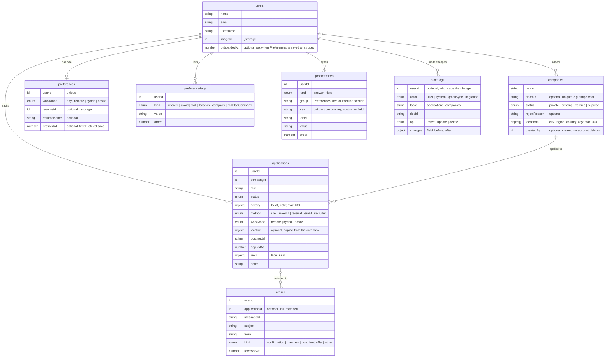
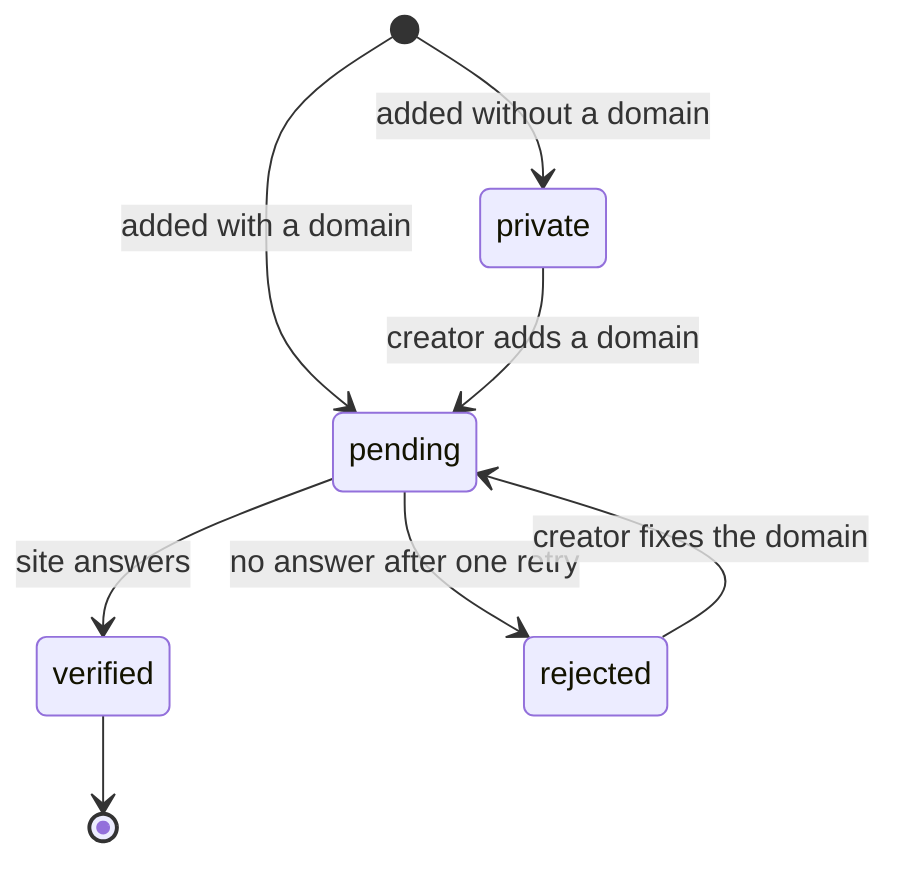
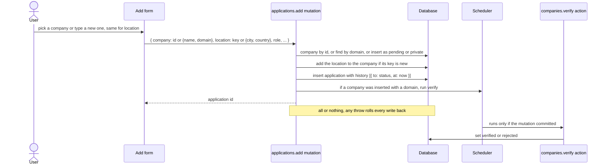
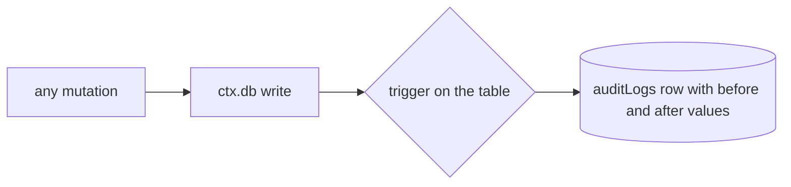
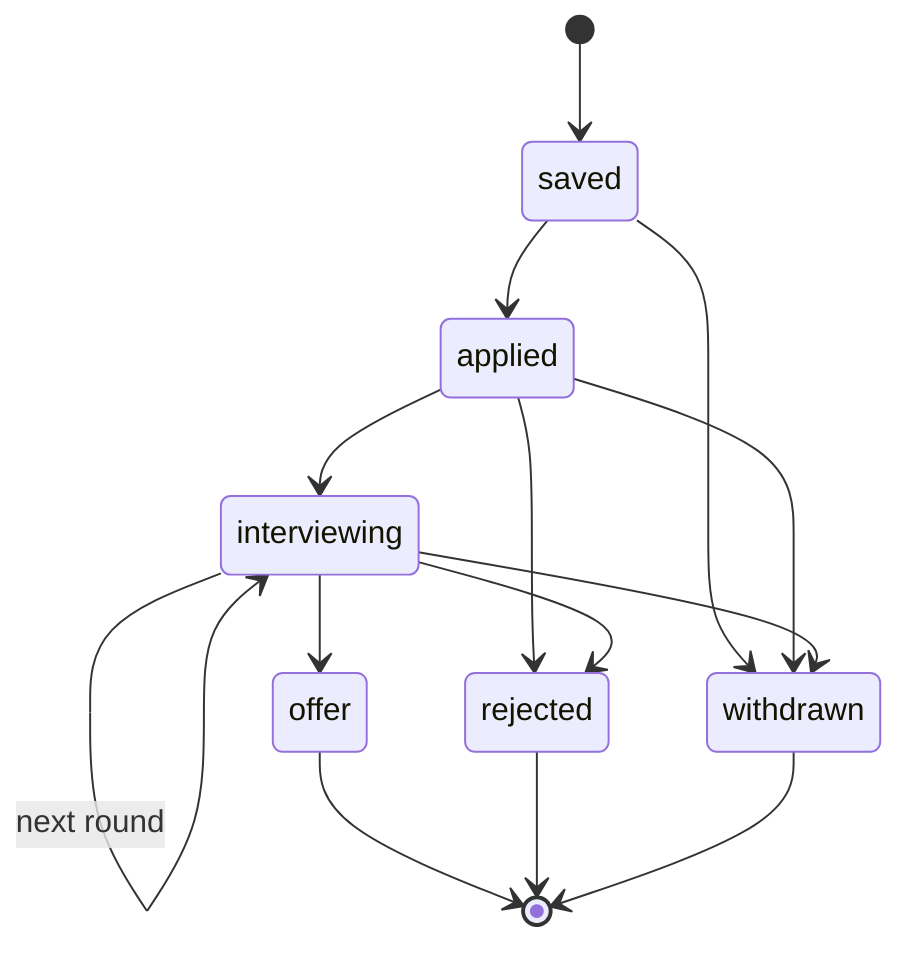
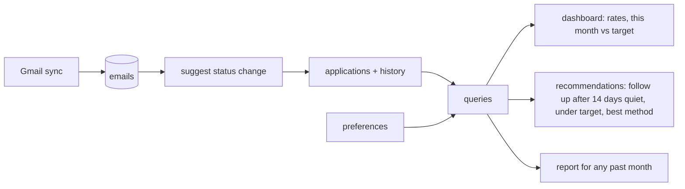
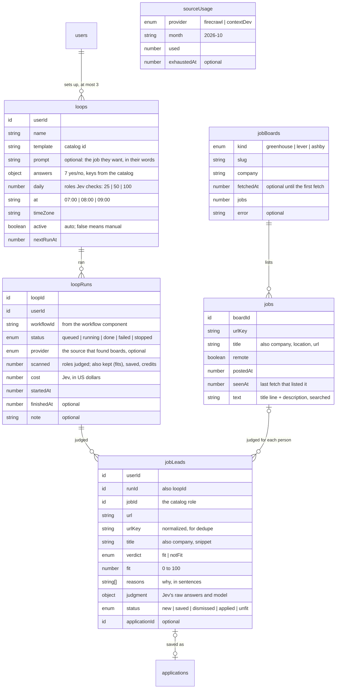
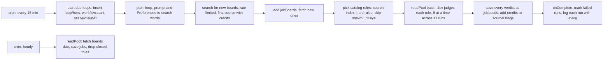
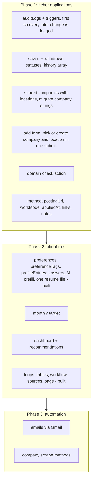

# Database design

A plan for growing the schema from `users` + `applications` into a full job-search tracker. Nothing here is built yet.

## When something gets its own table

Every table adds a schema, indexes, delete rules and an extra lookup when reading. A wish list item gets a table only when it passes at least one of these:

1. **It grows without a limit.** Convex caps a document at 1 MiB and an array at 8192 items. Audit rows, synced emails and applications grow forever, while a person's resumes or a company's offices don't.
2. **Several records point at it by id.** A resume sent with ten applications, or a company that many users apply to.
3. **It has its own owner or lifetime.** Shared companies stay after the user who added them deletes their account.
4. **You query it on its own, across parents.** "All emails I got this week" without loading every application.

Otherwise it is a field on its parent, either an object or an array with a cap.

Signs there are too many tables:

- A table that always has exactly one row per parent. Make it a field.
- A table that you only ever read together with its parent.
- A table that stores a number you could compute from other tables.
- Two tables recording the same event.

Applying that to the first draft removed three of its ten tables and kept a fourth from being added. `preferences` would also fold into `users` by these rules, but it stays a table on purpose: `users` holds only account details.

`preferences` started as one wide row holding every answer, tag list and Prefilled field. Each new question meant a schema change, every save rewrote the whole row, and its lists only grew. It is now three tables. `preferences` keeps the one-value settings. `preferenceTags` holds one row per tag and `profileEntries` one row per answer or form field, so both pass rule 1. Built-in questions are a list in code (`rows.ts`), keyed so a label can change without touching stored answers.

| First draft        | Fails because                                              | Now                                         |
| ------------------ | ---------------------------------------------------------- | ------------------------------------------- |
| `preferences`      | always one row per user                                    | kept as a table so `users` stays basic      |
| `companyLocations` | a few offices per company, only read with the company      | `companies.locations` array, capped at 200  |
| `statusEvents`     | a handful per application, only read with it               | `applications.history` array, capped at 100 |
| `reports`          | stores numbers computed from `applications.history`        | computed on demand                          |
| `interviews`       | never added, since rounds and dates fit in `history` notes | revisit if interviews need reminders        |

Twelve tables are planned, counting `users`. `users` and the three preferences tables exist today, phase 1 needs three more, and Loops needs four (see [Loops](#loops-finding-jobs-every-morning)).

| Table            | Passes rule                    | Phase |
| ---------------- | ------------------------------ | ----- |
| `users`          | exists                         | now   |
| `applications`   | 1, 4                           | 1     |
| `companies`      | 2, 3                           | 1     |
| `auditLogs`      | 1, 4                           | 1     |
| `preferences`    | exception: keeps `users` basic | now   |
| `preferenceTags` | 1                              | now   |
| `profileEntries` | 1                              | now   |
| `loops`          | 4                              | 2     |
| `loopRuns`       | 1                              | 2     |
| `jobLeads`       | 1, 4                           | 2     |
| `sourceUsage`    | 3                              | 2     |
| `emails`         | 1, 4                           | 3     |

## Where each wish list item lives

| Wish list item                            | Where it lives                                                                          |
| ----------------------------------------- | --------------------------------------------------------------------------------------- |
| company                                   | `companies`, a catalog shared by all users once verified                                |
| company locations                         | `companies.locations`, and each application copies the one it is for                    |
| role / job posting, custom links          | `applications.role`, `postingUrl`, `links`                                              |
| status                                    | `applications.status`, with every change appended to `applications.history`             |
| method of application                     | `applications.method`                                                                   |
| previous runs, snapshots from the past    | `applications.history`, which gives any application's status on any past date           |
| resumes                                   | one file on `preferences`, kept to attach to applications and never read                |
| user preferences, locations, custom roles | `preferences` settings, plus tags in `preferenceTags` and answers in `profileEntries`   |
| auto fill, prefilled applications         | `profileEntries` with kind `field`: form fields in sections, suggested from the answers |
| rate limits / monthly                     | a monthly target on `preferences` later, count from `applications.appliedAt`            |
| emails / method of tracking               | `emails` table in phase 3, which needs a Gmail connection                               |
| acceptance rate, interview rate           | computed from `applications.history`                                                    |
| recent reports                            | computed for any month on demand                                                        |
| recommendations, "what to do?"            | computed from stale applications, the monthly target and the best methods               |
| audit logs                                | `auditLogs` table, one row per write to any table                                       |

## Tables



`companies` is the only shared table. Everything else belongs to one user. Your notes about a company live on your applications, not on the shared company, so nothing personal ends up in the catalog.

### Relationships

Convex stores references as typed ids (`v.id("companies")`) but does not enforce them or cascade deletes. The "on delete" column is code the delete mutation must run.

| From             | To             | Kind        | Field                            | When the "to" record is deleted                                             |
| ---------------- | -------------- | ----------- | -------------------------------- | --------------------------------------------------------------------------- |
| `companies`      | `users`        | many to one | `createdBy`, optional            | delete the company if it is private and unused, otherwise clear `createdBy` |
| `applications`   | `users`        | many to one | `userId`                         | delete the application                                                      |
| `applications`   | `companies`    | many to one | `companyId`, required            | refuse while any user's application points at the company                   |
| `preferences`    | `users`        | one to one  | `userId`, unique                 | delete the row and its resume file                                          |
| `preferenceTags` | `users`        | many to one | `userId`                         | delete the tag                                                              |
| `profileEntries` | `users`        | many to one | `userId`                         | delete the entry                                                            |
| `emails`         | `applications` | many to one | `applicationId`, optional        | clear `applicationId` and keep the email                                    |
| `emails`         | `users`        | many to one | `userId`                         | delete the email                                                            |
| `auditLogs`      | `users`        | many to one | `userId`, optional               | delete the audit row                                                        |
| `auditLogs`      | any table      | loose       | `table` + `docId` (plain string) | keep the audit row after the record it describes is gone                    |

An application copies its location (`{ city, region, country }`) instead of pointing at an office by id. Nobody edits a location after adding it, so the copy never goes stale, and removing an office from a company can't break anyone's application.

### Indexes

| Table            | Index                                      | For                                              |
| ---------------- | ------------------------------------------ | ------------------------------------------------ |
| `companies`      | `by_domain`                                | dedupe, one company per domain                   |
| `companies`      | `by_createdBy_and_name`                    | my private companies, dedupe ones with no domain |
| `companies`      | search index on `name`, filter `status`    | the company picker searches verified ones        |
| `applications`   | `by_userId_and_status`                     | board columns, replacing `by_userId`             |
| `applications`   | `by_userId_and_appliedAt`                  | "this month" count, recent list                  |
| `applications`   | `by_companyId`                             | company page, per-company rates, delete check    |
| `preferences`    | `by_userId`, `by_resumeId`                 | load mine, check who owns an uploaded file       |
| `preferenceTags` | `by_userId_and_kind_and_order`             | my tags, paged, in the order they were added     |
| `profileEntries` | `by_userId_and_kind_and_order`             | my answers or my Prefilled fields, paged         |
| `emails`         | `by_userId_and_receivedAt`, `by_messageId` | inbox view, skip already-synced mail             |
| `auditLogs`      | `by_userId`                                | my activity, newest first                        |
| `auditLogs`      | `by_docId`                                 | history of one record                            |

`auditLogs` has no time field. `_creationTime` holds the time, and Convex adds it to every index as the last key, so both indexes return rows in time order.

## Shared companies

One user adds a company, and once it passes the website check, every user can pick it instead of typing it again. The website domain identifies the company, so `stripe.com` is one company whether someone typed "Stripe", "Stripe Inc." or "stripe".

### Is it real?

Until the scrape methods exist, "real" means "has a website that answers". That is a low bar, but it filters typos, made-up names and pasted job-board links, and it costs one request.



| Status     | Who can see and pick it                            | Who can edit it                        |
| ---------- | -------------------------------------------------- | -------------------------------------- |
| `private`  | its creator only                                   | its creator                            |
| `pending`  | its creator, and anyone who enters the same domain | its creator                            |
| `verified` | everyone, in search                                | nobody yet, until an admin role exists |
| `rejected` | its creator only, with the reason                  | its creator                            |

The checks run in this order.

1. **On input.** The shared arktype validator turns what you typed into a bare domain, so `https://www.Stripe.com/jobs` becomes `stripe.com`. It refuses IP addresses, `localhost` and names without a dot. It also refuses domains that are never a company's own site, such as job boards and ATSs like `linkedin.com`, `indeed.com`, `greenhouse.io`, `lever.co` and `workday.com`, free mail like `gmail.com` and `outlook.com`, and site hosts like `github.io` and `notion.site`. The error reads "That looks like a job board link. Enter the company's own website."
2. **After the add commits.** An internal action fetches `https://<domain>` with a 5 second timeout. Any HTTP answer, even a 403 from a bot blocker, shows the site exists, and the action marks the company `verified`. After a DNS or connection failure, the action tries once more an hour later, then marks the company `rejected` with the reason.
3. **Later, with scraping.** The scraper compares the site's title with the name, pulls the logo, and finds the careers page and offices.

A company with no website, such as a local shop or a stealth startup, stays `private`. Only the person who added it can see or pick it.

### Locations

`companies.locations` is an array of offices. Each office has a city, an optional region and an ISO country code from a fixed list, plus a normalized `key` like `us|ca|san francisco`. Adding a location whose key already exists reuses the existing entry. Anyone can add a location to a company they can see. Remote isn't a location, so it goes in `applications.workMode`.

Location tags in `preferenceTags` are free text for now, such as "Berlin" or "anywhere in the EU". Matching them to company offices needs geocoding, which can come with the scrape phase.

## Adding records that depend on each other

An application needs a company, and may need a location on that company. The user should not have to create them on separate screens in the right order.

One mutation creates all of them. A Convex mutation is a single transaction. If any step throws, Convex writes nothing, so a failed add never leaves an orphan company behind.



Rules for every "pick existing or create new" field:

- The argument is a union of `{ id }` to reuse or the draft fields to create. One arktype validator covers both, and the form and the mutation share it.
- Always look up before inserting. Find companies by `domain` when they have one and by `createdBy` plus name when they don't, and find locations by `key`. That keeps one record per real thing.
- Two users adding the same domain at the same moment is safe. Convex runs mutations as if one after the other, so the second one finds the first one's row.
- Check that the user may use a passed id, meaning the company is verified or theirs.
- Schedule follow-up work, such as verification and later the scraper, from inside the mutation with `ctx.scheduler.runAfter`. It then runs only if the add succeeded.

Files are the one exception. The browser uploads a resume to storage before the mutation that links it runs, so an abandoned form can leave an unused file. A daily cron deletes storage files that no `preferences` row has pointed at for a day.

In the form, the company field is a combobox. It searches verified companies plus your own, and its last option is "Add "what you typed"", which opens name and website fields in place. The location field works the same way and lists the chosen company's offices. The form saves nothing until you submit it.

## Audit logs

One `auditLogs` table covers every other table, rather than a log table per feature. Each row records who changed which record, when, and the values before and after. The "who" is a user, the system (the verify action), the Gmail sync or a migration.

It does not replace `applications.history`. An application keeps its history for as long as it exists, and the rates read it. Audit rows are generic, you read them rarely, for an activity page or when debugging why something changed, and a cron deletes them after a year.



How rows get written:

- `convex-helpers`, which is already installed, has triggers. A trigger registered on a table receives the old and new document on every insert, update and delete, inside the same transaction. Registering them once in the builders in `convex/lib/functions.ts` means every mutation logs without extra code.
- `actor` defaults to `user`, with `userId` set. The verify action, the Gmail sync and migrations pass their own `actor` and leave `userId` empty.

Rules:

- Store only the fields that changed, not whole documents.
- For `preferenceTags` and `profileEntries`, log which rows changed but not their values, since those include phone, salary and work authorization. The log should never be a second copy of private data.
- Deleting an account deletes that user's audit rows too, like everything else they own.
- Keep rows for one year. A monthly cron deletes older rows in batches.

## Status flow

The plan adds two statuses to today's four: `saved`, for a posting you found but haven't applied to, and `withdrawn`. Every arrow appends `{ to, at, note }` to `applications.history` in the same write that changes `applications.status`. One helper does both, so status and history always match.



The rates come from the history:

- The interview rate is the number of applications whose history reaches `interviewing`, divided by the number that reach `applied`.
- The acceptance rate is the number that reach `offer`, divided by the number that reach `applied`.
- Grouping either rate by `companyId` or `method` shows which kind of application works best.

## Where the numbers come from



Reports and rates read all of one user's applications. That works up to a few thousand applications per user, far more than a normal job search. Past that, a table of saved monthly numbers would be worth adding back.

## Loops: finding jobs every morning

A loop is a saved search that brings back jobs that fit, either by itself each morning (auto) or when the person presses Run now (manual). People set one up by going through the run's steps: they describe the job in their own words, answer yes or no, and pick from a few fixed sizes and start times, so the cost of every loop is known before it runs. The questions, templates, sizes, start times, source order and cost estimates are a catalog in code (`convex/api/features/loops/catalog.ts`) that the page and the backend share.

Roles come from one shared catalog, not from each person's own search. Greenhouse, Lever and Ashby each publish a free feed of every open role on a company's board, with the full description, so fetching a board costs nothing. The catalog starts from about 20 boards and refreshes each one daily; paid search (Firecrawl, then context.dev) is only used to find boards the catalog doesn't have yet. Each run then picks roles from the catalog and has [Jev](https://docs.typesafe.ai/introduction) judge each one for the person, through the Convex AI gateway (`typesafe/jev-1.14`). A 100-role morning costs about half a cent.

What a fitting job looks like isn't copied onto the loop. Each run reads the person's Preferences, so changing an interest today changes tomorrow's run.

### Tables



| Table         | Passes rule                                                     | Indexes                                                                                               |
| ------------- | --------------------------------------------------------------- | ----------------------------------------------------------------------------------------------------- |
| `loops`       | 4: the cron finds due loops across all users                    | `by_userId`, `by_active_and_nextRunAt`                                                                |
| `loopRuns`    | 1: one per loop per morning, kept for the Runs tab              | `by_loopId_and_startedAt`, `by_userId_and_startedAt`                                                  |
| `jobLeads`    | 1 and 4: grows every morning, and "shown this role?" spans runs | `by_userId_and_urlKey`, `by_runId`, `by_userId_and_status`                                            |
| `jobs`        | 3 and 4: shared by everyone, searched by every run              | `by_urlKey`, `by_boardId_and_seenAt`, `by_postedAt`, `by_remote_and_postedAt`, search index on `text` |
| `jobBoards`   | 3: shared by everyone; the refresh finds the ones due           | `by_kind_and_slug`, `by_fetchedAt`                                                                    |
| `sourceUsage` | 3: shared by everyone, one row per source per month             | `by_provider_and_month`                                                                               |

A judged role is saved for a person whether or not it fits, so it never comes back. `verdict` is Jev's call and never changes; `status` is what the person did, and roles that aren't a fit start as `unfit` so they stay out of New jobs. `reasons` are sentences a person can read ("A strong match for what you want. It's remote."), and `judgment` keeps Jev's raw answers (`match` from 0 to 3, the probability it touches something to avoid or is in their places, the model) so an agent or a later check can filter on numbers. Leads saved before Jev have no verdict.

Not tables: the questions and templates are a list in code, like the built-in Preferences questions, and a loop's answers are one object with the catalog's keys. Deleting an account deletes its loops, runs and leads; `jobs`, `jobBoards` and `sourceUsage` have no owner.

### What the components keep

The workflow, workpool and rate limiter components bring their own tables. The app never reads them directly; it keeps an id or calls the component.

| Component                  | Keeps                                                                             | The app keeps                         |
| -------------------------- | --------------------------------------------------------------------------------- | ------------------------------------- |
| `@convex-dev/workflow`     | each run's steps, retries and results                                             | `loopRuns.workflowId`                 |
| `@convex-dev/workpool`     | `readPool`: every board fetch and every Jev judgment, with its batch worker       | the run's judging tally on `loopRuns` |
| `@convex-dev/rate-limiter` | per-source call buckets shared by everyone, and 3 runs by hand per person per day | nothing                               |

`readPool` is the batch worker. The hourly refresh hands it the boards that are due, and a run hands it all its roles in one `enqueueActionBatch` call. It runs 8 at a time across everything, and each job retries twice. A judgment's `onComplete` adds the verdict to the run's tally on `loopRuns` (`readsLeft`, `candidates`, cost, failures), and the last one sends the workflow a `judged` event, which it waits for with `step.awaitEvent` before saving every verdict.

Jev needs no key: `@convex-dev/ai-sdk-provider` signs gateway calls with the deployment's own token, and the gateway bills the Convex team. Search sources' monthly credits come from the Convex env (`FIRECRAWL_MONTHLY_CREDITS`, `CONTEXT_DEV_MONTHLY_CREDITS`) and default to the free plans: 500 for Firecrawl and 1,000 for context.dev.

### One run



A run looks for boards with Firecrawl, then context.dev. It moves on once a source has used 90% of its monthly credits (`switchAt` in the catalog), or as soon as the source says it's out: Firecrawl answers 402 and context.dev answers 401 `USAGE_EXCEEDED`. That sets `exhaustedAt` until the month resets. With every source out, the run still judges roles from the boards the catalog already has.

Every run is logged as one wide event with [evlog](https://www.evlog.dev/): which sources it used and spent, how many roles Jev judged and how many fit, what Jev cost, how long it took and why it stopped. Board fetches and searches log one event each too. They print as JSON, so the Convex dashboard's logs can be searched by field (`convex/lib/log.ts`).

### Folders

The workflow machinery and the shared catalog are their own features; everything else follows the usual feature layout.

```text
convex/api/features/loops/          tables and the functions the page calls
  catalog.ts                         questions, templates, sizes, estimates
  models/                            loops.ts, runs.ts, leads.ts, usage.ts, index.ts
  validators.ts, schedule.ts         input checks; the next morning in a time zone
  public.ts, internal.ts             what the page calls; the cron, plan, judging tally and finish
convex/api/features/jobs/           the shared catalog
  boards.ts                          feed URLs, feed parsing, starter boards
  models/                            jobs.ts, boards.ts, index.ts
  public.ts, internal.ts, actions.ts search for the Jobs page; refresh, save, pick; fetchBoard
convex/api/features/workflows/      what runs a loop
  manager.ts                         WorkflowManager, readPool and the rate limits
  findJobs.ts                        the run, step by step
  actions.ts                         search (one batch) and judgeOne (one role, on readPool)
  judge.ts                           Jev's questions and the verdict rules
  fit.ts                             search words, URL dedupe
  sources/                           firecrawl.ts, contextDev.ts, index.ts (keys and credits)
convex/crons.ts                      every 15 minutes: start due loops; hourly: refresh boards
convex/convex.config.ts              app.use(workflow), app.use(workpool, { name: "readPool" }), app.use(rateLimiter)
convex/lib/log.ts                    evlog wide events
```

The search keys, `FIRECRAWL_API_KEY` and `CONTEXT_DEV_API_KEY`, go in the Convex env, declared in `convex.config.ts` like the auth keys. A source without a key is skipped.

## Build order



Phase 1 needs a migration, because `applications.company` is a string today. For each user, the migration creates one `private` company per distinct name, sets `companyId`, then drops `company`. Old companies have no domain, so they stay private until their owner adds a website. Existing rows also get `history: [{ to: status, at: _creationTime }]`.

## Open questions

- **Scoring loops.** Runs judge fit with rules only for now: interests, places, skills and red flags matched against each posting. Should an LLM also read each posting? That costs per posting, on top of the source credits.
- **Loop summaries.** The setup no longer offers an Inbox summary, since the Inbox runs on sample data. It comes back once there's a `notifications` table.
- **Plans.** Which Firecrawl and context.dev plans will this run on? Their monthly credits become `sourceUsage.limit`. Search now only finds boards, so the free plans go a long way.

- **Interviews.** Are notes in `history` enough, or do you want dates, rounds and calendar reminders? Reminders would make interviews pass rule 4 and need their own table.
- **Autofill.** Is this for a browser extension that fills forms, or answers you copy from the app? An extension needs the answers in a different shape.
- **Rate limits.** Do you mean a personal monthly target, as above, or a hard limit on something costly like AI-written cover letters? The second would use the `@convex-dev/rate-limiter` component, which brings its own tables.
- **Audit scope.** Should the log cover data changes only, as above, or also sign-ins, sign-outs and failed sign-ins? Auth events come from Convex Auth, not table writes, so they'd need their own hook.
- **Postings.** Will one posting ever need more than one application, for example when reapplying later? If yes, a `postings` table passes rule 2.
- **Fixing shared data.** Users can't edit a verified company with a wrong name, or a junk location someone added. Who fixes it, an admin role or a "suggest a change" queue?
- **Subsidiaries and regional sites.** Are `stripe.com` and `stripe.co.uk`, or Instagram and Meta, one company or several? This design treats each domain as its own company.
