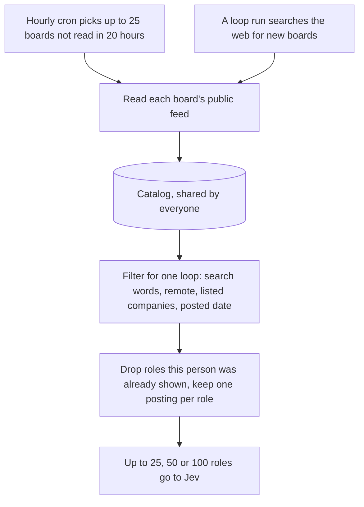
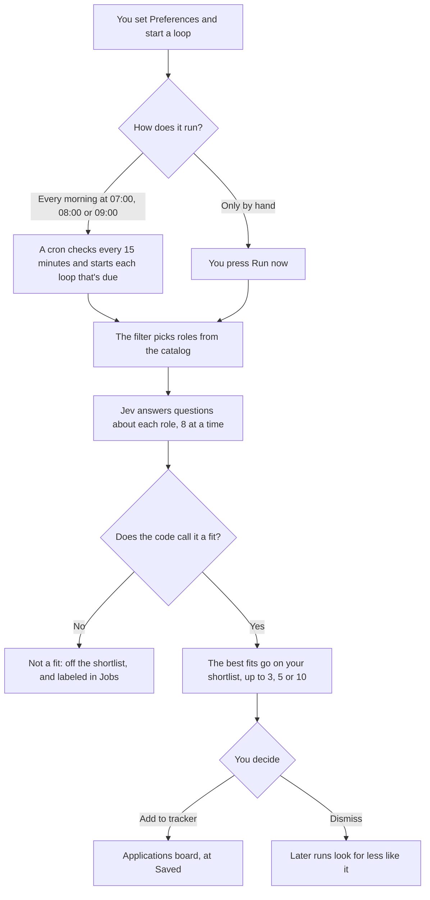

# How a job reaches your Applications board

A job goes through two stages. In the first, the app collects roles from the internet into one catalog that everyone searches. In the second, one of your loops filters that catalog, Jev judges what's left against what you asked for, and the best fits wait on your shortlist. A role joins your Applications board only when you add it.

For every detail and limit, see [Loops](flows.md#loops) and [Jobs](flows.md#jobs).

## Words

- **Cron:** a job that the backend starts on a timer. All of them are in `convex/crons.ts`.
- **Catalog:** every role the app has collected (the `jobs` table). Everyone shares it.
- **Loop:** a scheduled job with your settings attached: what to search for, when to run, how many roles to check, and how many to show.
- **Jev:** the model that answers typed questions about a role. Jev gives answers and confidence, not free text.
- **Shortlist:** the roles a loop picked for you, under **For you** on the Loops page.

## From the internet to the filter

The first stage ends at the filter, before any AI runs.

1. Every hour, the `refresh job boards` cron (`internal.api.jobs.refreshDue`) picks up to 25 boards that weren't read in the last 20 hours.
2. The batch worker reads each board's public feed, saves its roles, and drops the roles that the board no longer lists.
3. A loop run adds to the same catalog. It searches the web for job boards the app doesn't know yet and reads them too. A run with no search source left skips this and uses the boards the catalog already has.
4. The filter (`internal.api.jobs.candidates`) searches the catalog with words from your Preferences and the loop's prompt. It then applies whichever of the loop's rules are on: remote only, listed companies, and posted in the last 36 hours.
5. The filter skips any role you were already shown, under any of its postings. "New" means new to you, so an older role you never saw can still come up.
6. The filter stops at the loop's size: 25, 50 or 100 roles. A role past that limit isn't judged in this run.

Reading feeds and searching the index use no AI. Jev charges per token it reads, so the loop's size sets what a run spends on Jev.

## From your preferences to the board

The second stage starts when you set up a loop.

### When a loop runs

The `start due loops` cron wakes every 15 minutes and starts each loop whose time has come. With **Run by itself every morning** on, that's once a day at the time you picked. With it off, the loop runs only when you press **Run now**, 3 times a day at most. A workflow's **Find roles** step can also run a loop, whenever that workflow runs.

### What Jev is told

Each run builds a profile (`profileFor`) from these sources:

- The loop's prompt, which is the job in your own words.
- Your tags from Preferences: interests, skills, places, things to avoid, and red-flag companies.
- Your work mode, plus your answers about pay and visa.
- The roles you favorited or dismissed before.

The loop's answers decide which of these count. For example, your skills count only on a loop with stretch roles turned on.

Goals aren't in the profile, so they don't change what Jev thinks of a role. A goal that names a loop collects the roles you add from that loop, after Jev has judged them.

### How a role gets its verdict

Jev answers two kinds of question about each role (`questionsOf` in `convex/features/workflows/judge.ts`):

- **How well does it match?** A score from 0 (unrelated) to 3 (a strong match).
- **Does each need hold?** One question each for the place, up to 4 interests, up to 2 skills, up to 4 things to avoid, pay, and visa. The answer is that it holds, that it fails, or that the posting doesn't say.

Jev never decides the verdict. The code does (`verdictOf`), so one rule applies to every role. A role is a fit when all of these are true:

- The match score is at least 1.6 of 3, which shows as 53%. A fit below 2 of 3 is marked as a close call, because repeating a request can move a score across the line.
- No need fails, the role involves nothing you avoid, and the company isn't on your red-flag list. A failed need or an avoid only counts when Jev gives that answer at least 60%. Otherwise the check shows as a maybe.
- If you said where you want to work, the posting confirms the role works that way. Pay and visa can stay unclear.

To see what another cutoff would do to roles you've already rated, run `scripts/verdict-eval.mjs`. It replays stored answers and calls no model.

An interest or skill that fails doesn't rule a role out on its own. It only leaves that check off the role.

### Where the role goes next

At the end of the run, `finishRun` saves every verdict, and `fillShortlist` moves the best fits onto your shortlist until it holds as many as the loop shows: 3, 5 or 10. The other fits wait, and a later run can move them up. Roles that aren't a fit stay off the shortlist, and Jobs labels them **Not a fit**. Either way, the app doesn't judge that role for you again.

A role on your shortlist isn't on the board yet. **Add to tracker** (`api.loops.track`) creates the application at Saved, and sets its priority from the fit score. Favorite and dismiss change what later runs look for.

Prefilled applications and **New application** can also add to the board.
